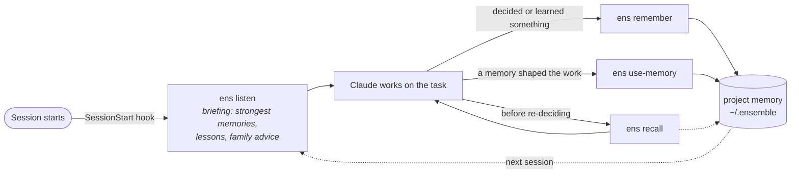
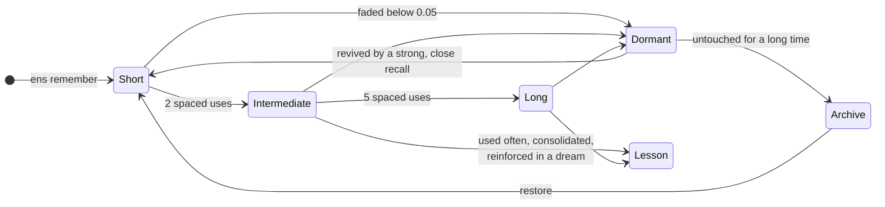
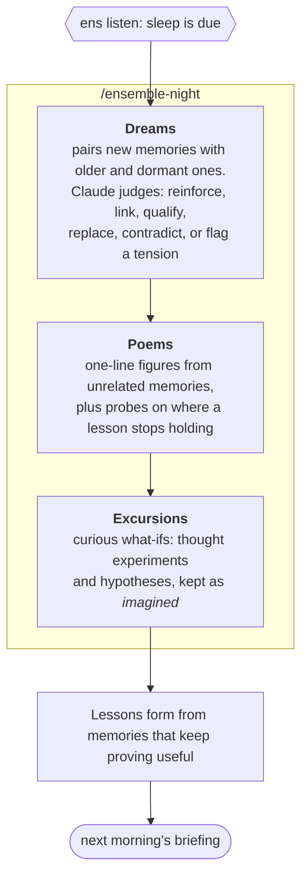

<p align="center">
  
</p>

<p align="center">
  <b>Long-lived, per-project memory for Claude Code.</b><br>
  It remembers what was decided and why, forgets what stops mattering, and works things over at night.
</p>

---

## TL;DR

- **What it is:** a small `ens` CLI, two Claude Code skills and a SessionStart hook. Claude remembers decisions, recalls them before re-deciding, and starts every session with a short briefing on what this project knows.
- **Why:** a new session only knows what's in the repo. Decisions and preferences that were only ever *said* ("whole grams only, please") get lost. Ensemble keeps them.
- **Does it work?** In a controlled A/B on real Claude sessions, Ensemble raised consistency with earlier decisions from **30/48 to 39/48**, and followed a preference that was only ever said in conversation **3/3 times vs 0/3** without it. Almost all of that came through the session-start briefing. Where the code already showed the answer, it made no difference. ([details](#what-the-lab-found))
- **What it costs:** about a third more turns per session and roughly 6% more spend in that test.
- **What makes it different:** memories fade unless used, harden into lessons when they keep proving useful, and get revisited in "nights" (dreams that link and reconcile memories). Related projects form a **family** and pass advice to their children.
- **Install:** `cd packages/ensemble && ./install.sh --hook`. No API keys, no server, plain files in `~/.ensemble`.

```console
$ ens listen
beat 0 | changed: none
memory: 3 active, 0 dormant, 0 lessons
  m00001 short 0.80: Whenever we show grams, whole grams only (the baker asked)
  m00002 short 0.70: Errors raise RecipeError, never ValueError
  m00003 short 0.60: A cup is 240 ml in this project
```

## Install

```bash
git clone https://github.com/TheHaymaker/ensemble-of-memories
cd ensemble-of-memories/packages/ensemble
./install.sh --hook          # add --mcp to also register it as an MCP server
```

This installs:

- **the `ens` command** in `~/.local/bin`, with its own Python environment in `~/.ensemble/venv`;
- **two skills** in `~/.claude/skills`: `ensemble` (everyday use) and `ensemble-night` (dreams, poems, excursions);
- **with `--hook`, a SessionStart hook** that runs `ens --listen`, so every session opens knowing the project's state. Your `~/.claude/settings.json` is backed up and merged, not replaced.

Then just work. Claude uses the skills by itself. Run `/ensemble-night` when `ens listen` says sleep is due, and use `ens listen`, `ens recall "..."`, `ens family-tree` and `ens help` from your terminal. The full guide is in [`packages/ensemble/README.md`](packages/ensemble/README.md).

## How it works

### A session



The briefing stays small (about 150 to 200 tokens of memory) however much the project has stored, because only the strongest active memories make it in.

### Memories fade, unless they're used



Every use raises a memory's floor a little, so something relied on often never goes dormant. Lessons don't fade, and only a vote can overturn one. When a newer memory replaces an older one, the older is marked **OUTDATED** and points to the newer.

### Nights

When enough new memories have piled up, `ens listen` says sleep is due and `/ensemble-night` runs one. Claude plays every part. Each step is a two-step exchange: `ens` proposes, Claude answers, and `ens` applies the answers.



The trust rules are strict. Anything a dream, poem or excursion makes is labelled *imagined* and stays an unconfirmed idea until a waking session actually uses it. Dreams can't overrule a waking memory or weaken a lesson. Poems are a playful extra: they add search keys and odd questions, and they settle nothing.

### Families and generations


Start a project with `ENSEMBLE_PARENTS=recipe-core` and it's born hearing its parent's most relied-on knowledge as **sayings**: advice only, adopted only if it fits. Traits like curiosity and skepticism are read from how each project actually lived, and children start from a blend of their relatives'. A long-lived project can **come of age** when the world its memories describe has changed; Ensemble suggests it, and you decide.

## What the lab found

This repo is also a lab. `harness/lab.py` runs real, headless Claude sessions against the small [test projects](test-projects), each in an isolated Ensemble home, and reports what memory looked like after every step.

The recall A/B ([PR #9](https://github.com/TheHaymaker/ensemble-of-memories/pull/9)) built up a history of decisions on a recipe project, then gave fresh sessions new tasks with and without Ensemble, 3 reps each, scored by checks and a blind judge:

| | with Ensemble | without |
|---|---|---|
| did what was asked | 60/60 | 60/60 |
| **consistent with earlier decisions** | **39/48 (81%)** | 30/48 (62%) |
| a preference only ever said in conversation | **3/3** | 0/3 |
| a child project following its parent's conventions | **6/6 checks** | 0/6 |
| blind judge, consistency (1 to 5) | **3.61** | 2.94 |
| blind judge, quality (1 to 5) | 3.72 | 3.67 |
| turns per session | 11.4 | 8.5 |
| cost per session | $0.26 | $0.24 |

**The honest reading:** Ensemble doesn't make Claude better at the work itself. It helps by carrying knowledge the repo doesn't contain. On probes where the earlier decision was visible in the code, tests or README, both arms scored the same. The session-start briefing carried every winning trial; dreams and poems played no visible part in that test. Samples are small, so only large effects show up. One failure it surfaced, a child inheriting a decision its parent had since overturned, is being fixed.

## This repo

| folder | what |
|---|---|
| [`packages/ensemble`](packages/ensemble) | Ensemble itself: the `ens` CLI, skills, SessionStart hook, MCP server, memory, dreams, poems, excursions and families. Install with `packages/ensemble/install.sh --hook`. |
| [`test-projects`](test-projects) | Small realistic projects to run Claude sessions against, related as a family (see `test-projects/family.json`). Each has a `tasks.json` of session prompts. |
| [`harness`](harness) | `lab.py`: runs headless Claude sessions and nights against the test projects, each run in its own isolated Ensemble home, with snapshots and a report. |
| [`assets`](assets) | the logo and banner |

Lab quick start:

```bash
python3 harness/lab.py setup                                   # once: .lab/venv with Ensemble's deps
python3 harness/lab.py play smoke1 harness/scenarios/smoke.json --fake   # offline, seconds
python3 harness/lab.py play smoke2 harness/scenarios/smoke.json          # real Claude, a few minutes
open runs/smoke2/report.md
```

Ensemble's own tests: `cd packages/ensemble && python3 test_claude_code.py` (and the other `test_*.py`).

<sub>The name comes from where it started: shared state for a group of agents, held in a single audio file where every vote is a tone and the mix is the tally. That engine is still in `packages/ensemble` (`ensemble.py`), next to the plain-markdown backend that Claude Code uses.</sub>
