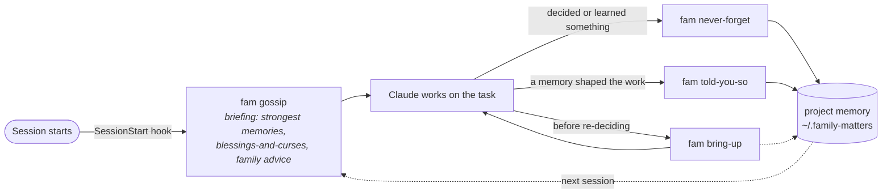
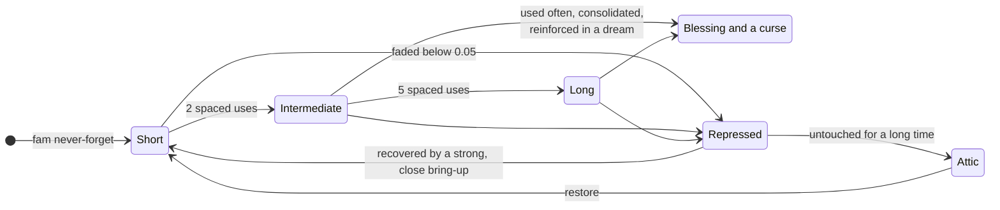
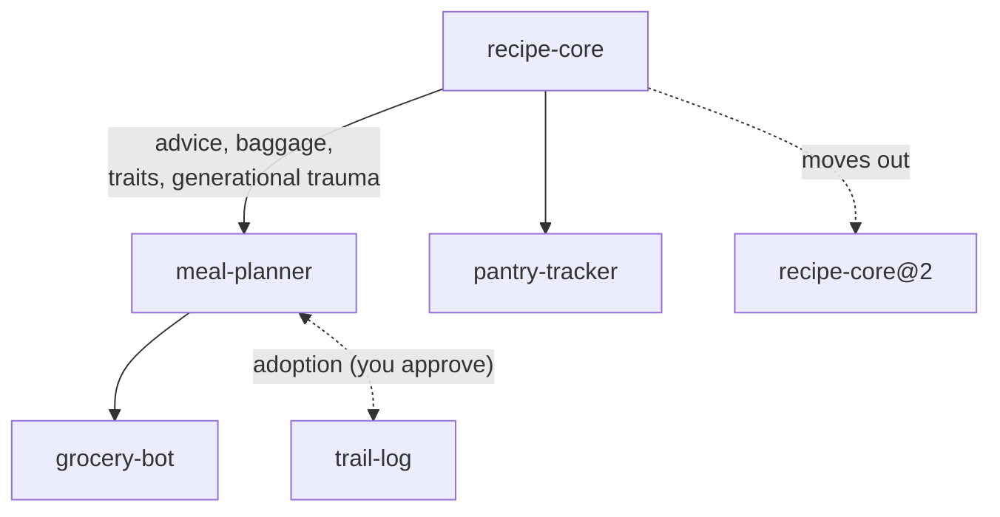
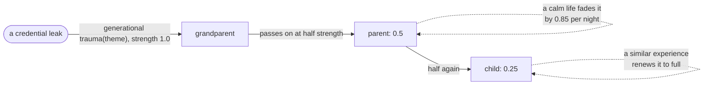

<p align="center">
  
</p>

<p align="center">
  <b>Long-lived, per-project memory for Claude Code.</b><br>
  It never forgets a decision, represses what stops mattering,<br>
  and hands its baggage down to the projects that come after.
</p>

---

## TL;DR

- **What:** a `fam` CLI, a few Claude Code skills and a SessionStart hook. Claude saves decisions (`fam never-forget`), checks them before re-deciding (`fam bring-up`), and opens every session with a short briefing (`fam gossip`).
- **Why:** a fresh session only knows what's in the repo. Things that were only ever *said* ("whole grams only, please") get lost. Family Matters keeps them.
- **Does it work?** In an A/B on real Claude sessions it raised consistency with earlier decisions from **30/48 to 39/48**, and honored a conversation-only preference **3/3 vs 0/3**. It doesn't help where the code already shows the answer. ([details](#what-the-lab-found))
- **Cost:** about a third more turns per session, about 6% more spend.
- **Different because** memories [fade unless used](#decay-forgetting-on-purpose), related projects [inherit from each other](#generations-and-generational-trauma), and [nights](#nights) revisit what was learned.
- **Install:** `cd packages/family-matters && ./install.sh --hook`. No API keys, no server, plain files in `~/.family-matters`.

```console
$ fam gossip
beat 0 | changed: none
memory: 2 active, 0 repressed, 0 blessings-and-curses
  m00001 short 0.80: Whenever we show grams, whole grams only (the baker asked)
  m00002 short 0.70: Errors raise RecipeError, never ValueError
```

## Install

```bash
git clone https://github.com/TheHaymaker/Ensemble-of-memories
cd Ensemble-of-memories/packages/family-matters
./install.sh --hook          # add --mcp to also register an MCP server
```

You get the `fam` command, the `family-matters` and `thats-not-how-i-remember-it` skills, and a SessionStart hook that runs the briefing. Your `~/.claude/settings.json` is backed up and merged. Then just work: Claude uses the skills on its own. From a terminal, try `fam gossip`, `fam bring-up "..."`, `fam tree` and `fam help`.

Coming from Ensemble? Re-run `./install.sh`. Your memory moves over and every `ens` command still works. The [package README](packages/family-matters/README.md) has every command and what the family calls things.

## How it works



The briefing holds only the strongest active memories, so it stays around 200 tokens however much is stored.

## Decay: forgetting on purpose

Every memory fades a little each beat. Using it slows the fade and moves it up a tier. Memories nobody uses are repressed: out of the briefing, but still searchable.



| tier | keeps per beat | gets there by |
|---|---|---|
| short | 80% | being new |
| intermediate | 95% | 2 uses, spaced apart |
| long | 99% | 5 spaced uses |
| repressed | stops fading | dropping below 0.05 |
| blessing-and-a-curse | never fades | 4+ uses, 2 nights consolidated, reinforced in a dream; only a vote overturns it |

Each use also raises a memory's floor, so one used about 7 times is never repressed. When a decision is overturned (`fam revise-history`, or `fam never-forget --replaces`), the old memory is marked outdated and never briefed, recalled or handed down again. In a 2,000-memory simulation, the briefing stayed under 200 tokens while 1,425 memories sat repressed on disk.

## Generations and generational trauma

Related projects form a family. What passes between them is advice and temperament, never rules.



- **Unsolicited advice.** Start a project with `FAM_PARENTS=recipe-core` and it's born hearing its parent's 3 most relied-on memories. They're labelled advice only. The child takes one (`fam take-advice`) if it fits, then has to confirm it by use. A few memories can also be handed down intact as **baggage**.
- **Traits.** Curiosity, skepticism, steadiness and expressiveness are read from how a project actually lived, and they tune its settings. A child starts from a blend of its relatives' traits until its own experience takes over.
- **Generational trauma.** A big experience, like a credential leak, leaves a lasting sensitivity to that theme. It passes down at half strength per generation, fades in a calm life, and comes back at full strength after a similar experience. See it with `fam generational-trauma`.



- **Moving out.** When the world a project's memories describe has changed (many decisions overturned, 60 nights, or talk of a rewrite or migration), Family Matters suggests a new generation. You decide: `fam move-out`, `fam stay-home`, or `fam midlife-crisis "v2 rewrite"` to do it now. The old generation retires as the parent of `project@2`.
- **Thanksgiving** (`fam thanksgiving`) gathers the family: advice that held up gains weight, advice voted down loses it, and when unrelated projects keep learning the same thing, it proposes an adoption for you to approve.

## Nights

When enough unprocessed memories pile up, `fam gossip` says therapy is overdue. Run `/thats-not-how-i-remember-it` (or one of seven aliases, such as `/things-will-look-better-in-the-morning`). Claude works through three steps:

1. **Dreams** pair new memories with older and repressed ones. Claude decides whether each pair reinforces, links, qualifies, replaces or contradicts, or is an open tension.
2. **Poems** make one-line figures from unrelated memories. They're a playful extra, not a proven gain: they add search keys and odd questions, and settle nothing.
3. **Excursions** follow curious what-ifs as thought experiments and hypotheses.

Anything a night invents is labelled *imagined* and stays an idea until a waking session actually uses it. Dreams can't overrule a waking memory.

## What the lab found

This repo is also a lab: `harness/lab.py` runs headless Claude sessions against the [test projects](test-projects) and records what memory looked like after every step.

The recall A/B ([PR #9](https://github.com/TheHaymaker/Ensemble-of-memories/pull/9)) built a history of decisions on a recipe project, then gave fresh sessions new tasks with and without memory (3 reps each, checks plus a blind judge):

| | with memory | without |
|---|---|---|
| did what was asked | 60/60 | 60/60 |
| **consistent with earlier decisions** | **39/48** | 30/48 |
| a preference only ever said in chat | **3/3** | 0/3 |
| a child following its parent's conventions | **6/6** | 0/6 |
| blind judge: consistency / quality (1 to 5) | **3.61** / 3.72 | 2.94 / 3.67 |
| turns / cost per session | 11.4 / $0.26 | 8.5 / $0.24 |

Memory doesn't make Claude better at the work. It carries what the repo doesn't hold, almost entirely through the session-start briefing. Dreams and poems played no visible part. Samples are small, so only large effects show. The one failure it found, a child inheriting a decision its parent had overturned, is now fixed (`fam revise-history`).

## This repo

| folder | what |
|---|---|
| [`packages/family-matters`](packages/family-matters) | the `fam` CLI, skills, hook, MCP server and the memory engine |
| [`test-projects`](test-projects) | small related projects for Claude sessions to work on, each with a `tasks.json` |
| [`harness`](harness) | `lab.py`: runs sessions and nights in isolated homes, with snapshots and a report |
| [`assets`](assets) | logo and banner |

```bash
python3 harness/lab.py setup                                              # once
python3 harness/lab.py play smoke1 harness/scenarios/smoke.json --fake    # offline, seconds
python3 harness/lab.py play smoke2 harness/scenarios/smoke.json           # real Claude, a few minutes
```

Tests: `cd packages/family-matters && python3 test_claude_code.py` (and the other `test_*.py`).

<sub>Family Matters is built on **Ensemble**, a shared-state engine for groups of agents that started life as a single audio file where every vote is a tone and the mix is the tally. That's why the engine's files keep the name and `ens` still works.</sub>
