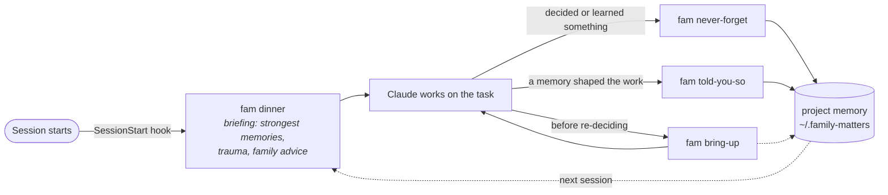
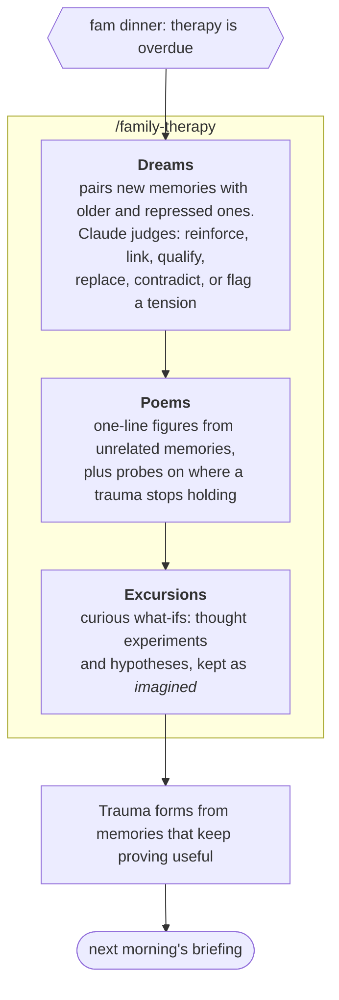
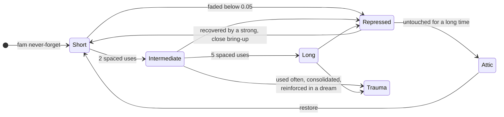
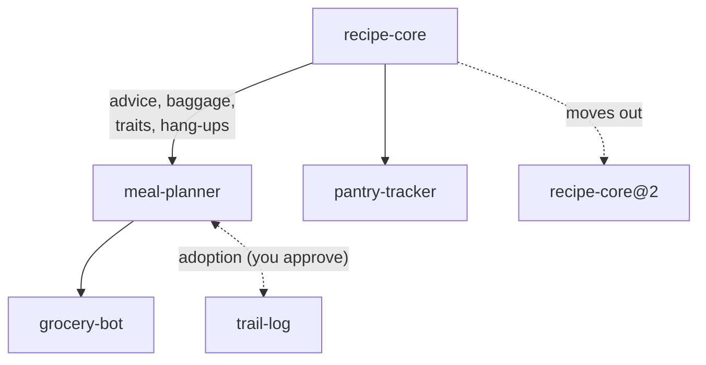
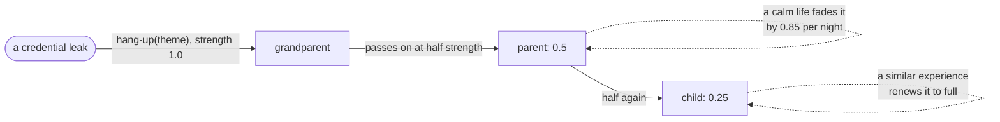

<p align="center">
  
</p>

<p align="center">
  <b>Long-lived, per-project memory for Claude Code.</b><br>
  It never forgets what was decided and why, represses what stops mattering,<br>
  hardens what hurt into trauma, and hands its baggage down to the projects that come after.
</p>

---

## TL;DR

- **What it is:** a small `fam` CLI, two Claude Code skills and a SessionStart hook. Claude remembers decisions (`fam never-forget`), brings them up before re-deciding (`fam bring-up`), and starts every session at family dinner: a short briefing on what this project knows.
- **Why:** a new session only knows what's in the repo. Decisions and preferences that were only ever *said* ("whole grams only, please") get lost. Family Matters keeps them, and will bring them up again. And again.
- **Does it work?** In a controlled A/B on real Claude sessions, it raised consistency with earlier decisions from **30/48 to 39/48**, and followed a preference that was only ever said in conversation **3/3 times vs 0/3** without it. Almost all of that came through the session-start briefing. Where the code already showed the answer, it made no difference. ([details](#what-the-lab-found))
- **What it costs:** about a third more turns per session and roughly 6% more spend in that test.
- **What makes it different:**
  - **[Decay](#decay-forgetting-on-purpose).** Memories fade unless they're used, get repressed, and can be recovered. What keeps proving useful hardens into **trauma** that never fades. The briefing stays around 200 tokens however much is stored.
  - **[Generations and epigenetics](#generations-and-epigenetics).** Related projects form a family. Children are born hearing their parents' best-tested knowledge as unsolicited advice, inherit their temperament as traits, and carry big experiences (like a credential leak) as inherited hang-ups that weaken with each generation. A project that outgrows its world moves out as a new generation.
  - **[Family therapy](#family-therapy).** Dreams revisit and reconcile memories while Claude sleeps on it.
- **Install:** `cd packages/family-matters && ./install.sh --hook`. No API keys, no server, plain files in `~/.family-matters`.

```console
$ fam dinner
beat 0 | changed: none
memory: 3 active, 0 repressed, 0 trauma
  m00001 short 0.80: Whenever we show grams, whole grams only (the baker asked)
  m00002 short 0.70: Errors raise RecipeError, never ValueError
  m00003 short 0.60: A cup is 240 ml in this project
```

## Install

```bash
git clone https://github.com/TheHaymaker/ensemble-of-memories
cd ensemble-of-memories/packages/family-matters
./install.sh --hook          # add --mcp to also register it as an MCP server
```

This installs:

- **the `fam` command** in `~/.local/bin`, with its own Python environment in `~/.family-matters/venv`;
- **two skills** in `~/.claude/skills`: `family-matters` (everyday use) and `family-therapy` (dreams, poems, excursions);
- **with `--hook`, a SessionStart hook** that runs `fam --listen` (family dinner), so every session opens knowing the project's state. Your `~/.claude/settings.json` is backed up and merged, not replaced.

Then just work. Claude uses the skills by itself. Run `/family-therapy` when `fam dinner` says therapy is overdue, and use `fam dinner`, `fam bring-up "..."`, `fam tree` and `fam help` from your terminal. The full guide, with every command and what the family calls things, is in [`packages/family-matters/README.md`](packages/family-matters/README.md).

**Coming from Ensemble?** Re-run `./install.sh`. It moves `~/.ensemble` to `~/.family-matters`, keeps `ens` working as a shim for `fam`, and swaps in the new skills and hook. Old command names (`ens listen`, `ens remember`, `ens lessons`) and `ENSEMBLE_*` variables still work.

## How it works

### A session



The briefing stays small (about 150 to 200 tokens of memory) however much the project has stored, because only the strongest active memories make it in.

### Family therapy

When enough unprocessed memories have piled up, `fam dinner` says therapy is overdue and `/family-therapy` runs a night of it. Claude plays every part. Each step is a two-step exchange: `fam` proposes, Claude answers, and `fam` applies the answers.



The trust rules are strict. Anything a dream, poem or excursion makes is labelled *imagined* and stays an unconfirmed idea until a waking session actually uses it. Dreams can't overrule a waking memory or soften a trauma. Poems are a playful extra: they add search keys and odd questions, and they settle nothing.

## Decay: forgetting on purpose

Most memory tools only grow. Family Matters represses, on purpose, so the briefing stays short and current. Every memory has a strength that fades a little each beat, at a rate set by its tier, and only being **used** slows it down.



| tier | keeps per beat | how a memory gets there |
|---|---|---|
| short | 80% | every new memory starts here |
| intermediate | 95% | 2 uses, at least 3 beats apart |
| long | 99% | 5 spaced uses |
| repressed | stops fading | strength fell below 0.05; left out of the briefing, still searchable |
| trauma | never fades | used 4+ times, consolidated for 2 nights, reinforced in a dream; only settling an argument (a vote) overturns it |

- **Spacing, not cramming.** Several uses in one beat count once. Only uses spread over time promote a memory.
- **Buffs.** Every use permanently raises a memory's floor a little (the n-th use adds 0.02/n, up to 0.15). After about 7 uses it can never be repressed.
- **Recovered memories.** A repressed memory comes back only when a bring-up is both strong and close to it, then has to earn its place again.
- **The attic.** A repressed memory that therapy keeps finding no use for, and that nobody touches for a long time, goes up to a compressed archive. `restore()` brings it back down.
- **Revisionist history.** When a newer memory overturns an older one (`fam revise-history`, or `--replaces`), the older is cut to 30% strength and marked **OUTDATED**, pointing to the newer, and is never handed down.

The result is a flat briefing. In a 500-beat simulation with 2,000 memories, the summary stayed under about 200 tokens while 1,425 memories sat repressed on disk.

## Generations and epigenetics

Projects form families. Each project keeps its own memory, and what passes between relatives is advice, temperament and baggage, never rules.



**Born with unsolicited advice.** Start a project with `FAM_PARENTS=recipe-core` and it's born hearing its parent's 3 most relied-on memories as **advice**, trauma first. It shows up in the briefing as "unsolicited, advice only". The child takes it (`fam take-advice`) only if it fits, and it then has to be confirmed by use like any new idea. A few specific memories can also be handed down intact as **baggage**.

**Traits.** Curiosity, skepticism, steadiness and expressiveness are read from how each project actually lived, and they tune its settings: excursions per night, how high the dream judge's bar is, how many uses it takes to confirm an idea or form a trauma. A child starts from a blend of its relatives' traits (parent 1, grandparent 0.5, sibling 0.3, aunt or uncle 0.15), and its own experience takes over as it lives.

**Hang-ups (epigenetic marks).** A big experience, like a credential leak, leaves a **hang-up**: heightened sensitivity to that theme, so related memories count for more. Like any good hang-up, it gets passed down.



**Generations.** A long-lived project **moves out** when the world its memories describe has changed, not when it gets big. Family Matters suggests it when a lot of its knowledge has been overturned, after 60 nights, or when memories mention a release, rewrite or migration. You decide (`fam move-out`, or `fam stay-home` to put it off), or have a `fam midlife-crisis "v2 rewrite"` and do it now. The current generation then retires as the parent: its trauma becomes advice, its most relied-on memories become baggage, and `project@2` starts fresh while hearing its predecessor as advice.

**Thanksgiving** (`fam thanksgiving`, the family reunion) gathers everyone: trauma is retold as advice, advice that was taken and held up gains weight, advice that was voted down loses it, and trauma that recurs across members becomes family lore. When unrelated projects keep learning the same lessons, Thanksgiving proposes an adoption for you to approve (`fam adopt`). `fam tree` draws it all, skeletons included, as an HTML page and a Mermaid chart.

## What the lab found

This repo is also a lab. `harness/lab.py` runs real, headless Claude sessions against the small [test projects](test-projects), each in an isolated Family Matters home, and reports what memory looked like after every step.

The recall A/B ([PR #9](https://github.com/TheHaymaker/ensemble-of-memories/pull/9)) built up a history of decisions on a recipe project, then gave fresh sessions new tasks with and without memory, 3 reps each, scored by checks and a blind judge:

| | with memory | without |
|---|---|---|
| did what was asked | 60/60 | 60/60 |
| **consistent with earlier decisions** | **39/48 (81%)** | 30/48 (62%) |
| a preference only ever said in conversation | **3/3** | 0/3 |
| a child project following its parent's conventions | **6/6 checks** | 0/6 |
| blind judge, consistency (1 to 5) | **3.61** | 2.94 |
| blind judge, quality (1 to 5) | 3.72 | 3.67 |
| turns per session | 11.4 | 8.5 |
| cost per session | $0.26 | $0.24 |

**The honest reading:** memory doesn't make Claude better at the work itself. It helps by carrying knowledge the repo doesn't contain. On probes where the earlier decision was visible in the code, tests or README, both arms scored the same. The session-start briefing (family dinner) carried every winning trial; dreams and poems played no visible part in that test. Samples are small, so only large effects show up. One failure it surfaced, a child inheriting a decision its parent had since overturned, is being fixed.

## This repo

| folder | what |
|---|---|
| [`packages/family-matters`](packages/family-matters) | The `fam` CLI, skills, SessionStart hook, MCP server, memory, dreams, poems, excursions and families, on the Ensemble engine. Install with `packages/family-matters/install.sh --hook`. |
| [`test-projects`](test-projects) | Small realistic projects to run Claude sessions against, related as a family (see `test-projects/family.json`). Each has a `tasks.json` of session prompts. |
| [`harness`](harness) | `lab.py`: runs headless Claude sessions and nights against the test projects, each run in its own isolated home, with snapshots and a report. |
| [`assets`](assets) | the logo and banner |

Lab quick start:

```bash
python3 harness/lab.py setup                                   # once: .lab/venv with the deps
python3 harness/lab.py play smoke1 harness/scenarios/smoke.json --fake   # offline, seconds
python3 harness/lab.py play smoke2 harness/scenarios/smoke.json          # real Claude, a few minutes
open runs/smoke2/report.md
```

Its own tests: `cd packages/family-matters && python3 test_claude_code.py` (and the other `test_*.py`).

<sub>Under the hood, Family Matters is built on **Ensemble**, which is why the engine's files keep that name and `ens` still works as an alias for `fam`. Ensemble started as shared state for a group of agents, held in a single audio file where every vote is a tone and the mix is the tally. That engine is still there (`ensemble.py`), next to the plain-markdown backend that Claude Code uses.</sub>
